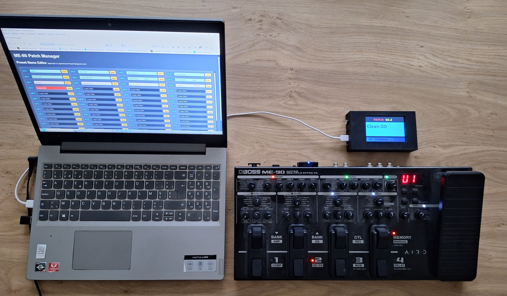
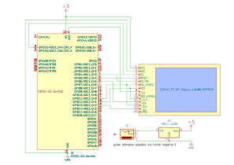
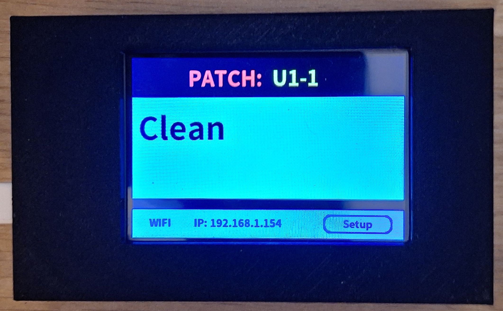
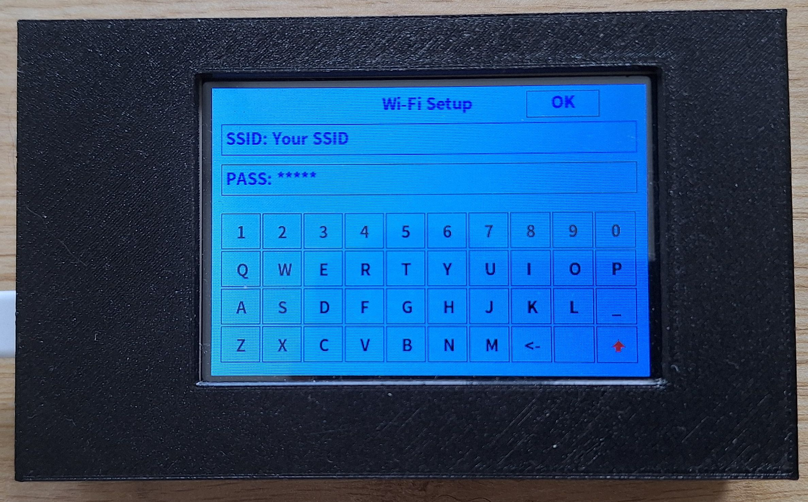
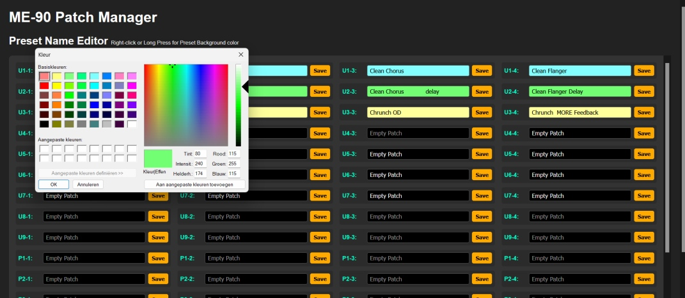

# BOSS ME-90 Wireless BLE-MIDI Patch & Preset Display


[](https://opensource.org)  
[](https://espressif.com)  
[](https://github.com)


A DIY, open-source wireless MIDI patch and preset display built on the **ESP32-S3** using **pioarduino** (the modern community fork of PlatformIO). It is tailored to display full preset names for the **BOSS ME-90**, but can easily be adapted for other guitar multi-effects processors or stompboxes.

---

## 🎸 The Problem & The Solution

The **BOSS ME-90** is an incredible processor, but its built-in 2-digit 7-segment display makes it tough to keep track of custom **preset names** on a dark stage. This project uses an **ESP32-S3** and a 3.5-inch TFT display to automatically pair wirelessly with the **BOSS BT-DUAL** adapter on the **ME-90** over Bluetooth, intercepting incoming **MIDI Program Change (PC) messages**, and instantly display high-visibility text along with custom user-assigned background colors **on a beautiful large TFT screen**.

### 🌟 Key Features
* **100% Wireless Connection:** Operates via **MIDI-BLE (Bluetooth Low Energy)** with no physical cables needed.
* **Onboard Wi-Fi Setup:** Features a built-in touch-keyboard for local network configuration.
* **Local Web Patch Manager:** Access a browser-based local server via IP address to edit preset names instantly.
* **Stage Color-Coding:** Color-code patches (e.g., green for rhythm, red for lead) for quick visual cues during live performance.


---

## 🛠️ Project Overview & Interface

Below you can see the complete system workspace configuration including the Web Manager interface alongside the physical hardware unit synchronized with the Boss ME-90 processor.



---

## 📦 Hardware Required  
* **Microcontroller:** ESP32 Development Board ESP32-S3-DevKitC-1 N8R8 (official board)  
* **Display:** 3.5-inch 480x320 TFT SPI Module ILI9488 SKU MSP3520 (with touch screen)  
* **Power:** DC/DC buck converter to drop the 9V pedalboard power adapter (Warning: Ring = positive!) down to 5V    
* **Enclosure:** Project box enclosure (an STL file is provided in the repository for 3D printing)
* **Connectors:** Assorted wiring, solder, and connectors as required.

---

## 🔌 Wiring Schematic (TFT Screen & Touch Controller)

```text
GPIO 11 -> TFT SDI/MOSI pin and Touchscreen Controller T_DIN pin (shared)
GPIO 13 -> Touchscreen Controller T_DO pin

           ⚠️ NO CONNECTION TO THE TFT SDO/MISO PIN!
           The red ILI9488 SPI-displays have a known hardware bus bug. 
           Leaving the display MISO-pin connected blocks the SPI bus, which 
           prevents the XPT2046 touch controller from working. 
           The TFT SDO/MISO line is not required for operation anyway.

GPIO 12 -> TFT SCK pin and Touchscreen Controller T_CLK pin (shared)
GPIO 15 -> TFT CS pin
GPIO 4  -> TFT DC/RS pin
GPIO 5  -> TFT RESET pin
GPIO 6  -> Touchscreen Controller T_CS pin (Note: T_IRQ is left disconnected)
GND     -> GND
5V      -> VCC (Do not solder jumper J1 on the screen board)
3V3     -> LED (The LED pin controls the Q1 transistor, meaning there is zero heavy 
                current draw here. At 3V3 the display reaches a perfect stage brightness.)
```
---

## 🚀 How to Use

### 1. Initial Setup & Wi-Fi Configuration
* **Power On:** Turn on the display unit to initialize the main screen interface.
* **Open Settings:** Tap the **Setup** button on the main screen to navigate to the network configuration menu.

| Main Display | Wi-Fi Keyboard Interface |
| :---: | :---: |
|  |  |

* **Enter Credentials:** Use the responsive on-screen touch keyboard to type in your local Wi-Fi network name (**SSID**) and network **Password**.
* **Save & Exit:** Press the **OK** button. The system will securely save your settings and automatically return you to the main screen.
* **Get IP Address:** Once connected, the unit's newly assigned **IP Address** will appear directly on the bottom row of the main screen.

### 2. Managing Patches & Customizing Colors via Webserver
* **Access the Webserver:** Open any web browser on a computer, tablet, or smartphone connected to the same Wi-Fi network and enter the displayed IP address into your URL bar.
* **Edit Patch Names:** Use the clean, built-in **ME-90 Patch Manager** web interface to type out full names for your custom guitar patches.



* **Customize Background Colors:**
  * **On a Computer:** Right-click a patch row to open the system color picker palette.
  * **On a Mobile Device:** Long-press a patch row to trigger the color picker layout.
  * *Stage Tip:* Color-code your patches (e.g., light blue for clean, green for rhythm, red for lead solos, yellow for ambient modulations) to instantly recognize your layout under dark stage lighting!
* **Save Changes:** Click the individual **Save** button next to each patch row to commit changes to the onboard filesystem.

### 3. Wireless Performance Mode (MIDI-BLE Only)
* **Wireless Connection:** Ensure your Boss ME-90 has its official Bluetooth Audio MIDI Dual Adaptor (**BT-DUAL**) active.
* **Auto-Pairing:** Turn on both devices. The display unit operates **exclusively via MIDI-BLE (Bluetooth Low Energy)** and will automatically scan, pair, and bond directly to your Boss ME-90—no messy physical MIDI cables or hardware input jacks required.
* **Initial Sync (Important Note):** When powering on the entire setup for the first time, you must step on the ME-90 patch switches to shift to an alternate patch, and then click back to your initial patch. The Boss ME-90 hardware does not natively broadcast a MIDI Program Change (PC) command upon boot up; this initial cycle forces the wireless message to send, synchronizing the display.
* **Performance Play:** Once synchronized, step on your ME-90 patch switches as normal during live play. The ESP32 unit will instantly intercept the wireless PC messages and refresh the high-visibility TFT screen with your custom patch name and background color.

## 👨‍💻 Author:
Created by Paul van der Vleuten
